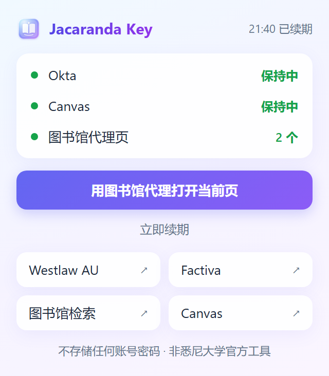

[中文](README.md) | **English**

# Jacaranda Key · Stay signed in & library proxy for USYD

A small Chrome extension for University of Sydney (USYD) students. It does two things:

1. **Fewer sign-outs** — while your browser is open, it refreshes your Okta / Canvas session every 18 minutes, and ticks "Keep me signed in" on the Okta sign-in page.
2. **Library access in one click** — on a journal or news site, reopen the current page through the USYD Library's OpenAthens proxy. Shortcuts to Westlaw AU, Factiva, Library Search and Canvas are included.

**It never stores, reads or fills in any username, password or verification code.**



> For personal study use only. Not affiliated with the University of Sydney. Please read the [Disclaimer](#disclaimer) before use.

> The extension's interface is in Chinese. The buttons, top to bottom: *Open current page via library proxy*, *Refresh now*, then the four shortcuts.

---

## Install (about 3 minutes)

### 1. Download

Download the latest `jacaranda-key-v*.zip` from **Releases** on the right of this page.

### 2. Unzip it somewhere permanent

Right-click the zip → Extract All, and put the folder **somewhere you won't delete**, e.g. `Documents\jacaranda-key`.

- The extension runs from this folder. If you delete or move it, the extension stops working.
- Open the folder and check that you can **see `manifest.json` right away**. If there is another folder inside, select that inner folder in the next step.

### 3. Load it into Chrome

1. Go to `chrome://extensions`
2. Turn on **Developer mode** (top right)
3. Click **Load unpacked** (top left)
4. Select the folder that directly contains `manifest.json`

Other Chromium-based browsers (e.g. Edge) work similarly, but the author has only tested Chrome.

### 4. Pin the icon

Click the puzzle icon 🧩 in the toolbar → find **Jacaranda Key** → click the pin 📌.

### 5. Check it works

1. Sign in to Canvas once as usual (https://canvas.sydney.edu.au)
2. Click the extension icon → click 立即续期 (*Refresh now*)
3. The badge shows **ON** while your session is being kept alive. **EXP** means you are not signed in — just sign in once.

---

## Usage

- **Hit a paywall?** On that page, click the extension icon → 用图书馆代理打开当前页 (*Open via library proxy*). The first time, you'll be asked to sign in with your UniKey (the extension picks the UniKey option for you).
  - On USYD's own pages (Canvas, the Okta sign-in page, the library site) the button is greyed out — those pages don't need the proxy.
- **Shortcuts:** the four links at the bottom open in a new tab.

---

## FAQ

**Do I have to sign in again after restarting the browser or computer?**
Usually not. The extension keeps your USYD sign-in cookies for 400 days, so you can pick up where you left off.
If the browser was closed long enough for USYD's session to expire, you'll need to sign in once more — the extension then keeps that session alive.
The extension itself stays installed as long as the folder isn't deleted or moved.

**Does it work in Incognito?**
Yes, but you need to switch it on (Chrome doesn't run extensions in Incognito by default):
`chrome://extensions` → Jacaranda Key → **Details** → turn on **Allow in Incognito**.
After that, sign-ins in Incognito windows are refreshed every 18 minutes too. When you close all Incognito windows, those sign-ins are cleared as usual — the extension doesn't keep them.

**"We are sorry that we cannot complete your request" after using the proxy?**
OpenAthens doesn't recognise the site: either the USYD Library doesn't provide that resource through OpenAthens, or the page isn't a resource page (e.g. a sign-in page).

**"Manifest file is missing or unreadable" when loading?**
You selected the wrong folder level. Pick the one that **directly contains `manifest.json`**.

**Badge stays on EXP?**
Sign in to Canvas manually once, then click 立即续期 (*Refresh now*).

**How do I update?**
Download the new version → overwrite the files in your folder → open `chrome://extensions` → click the reload icon 🔄 on the Jacaranda Key card.

**How do I uninstall?**
`chrome://extensions` → Jacaranda Key → **Remove**, then delete the folder.

---

## Security

**What it does and doesn't do**

- It never stores, reads or fills in any username, password or verification code.
- It sends no data to the author and talks to no third-party servers. Network requests go only to:
  - `sso.sydney.edu.au` (Okta session refresh)
  - `canvas.sydney.edu.au` (checks whether Canvas is signed in)
  - library proxy pages you already have open on `*.proxy.openathens.net` (keep-alive)
- On web pages it only does two things: ticks "Keep me signed in" on the Okta sign-in page, and selects the UniKey option on OpenAthens.
- It only changes how long `sso.sydney.edu.au`'s own sign-in cookies are kept (so they survive a browser restart). It doesn't read their contents or send them anywhere. Incognito cookies are left alone.
- Permissions requested: `alarms` (timer), `storage` (last refresh result), `activeTab` (read the current page's URL when you click the button), `cookies` (the point above), plus access to the sites above.

**Things to be aware of**

- **A longer session also means anyone using your computer can get into your account more easily.** Your sign-in survives closing the browser, so don't install it on public or shared computers, and lock your own computer with a password. To sign out completely, use "Sign out" on the USYD site.
- Unpacked extensions **don't auto-update**. Upside: nobody (including the author) can push changes to your computer. Downside: you need to download new versions yourself.
- **Only download from this repository.** Re-uploaded copies may have been modified. To check, open the `.js` files in a text editor and search for `http` — every URL should belong to `sydney.edu.au`, `openathens.net` or `exlibrisgroup.com`.

Files:

```
manifest.json          extension config
background.js          refresh every 18 minutes
content-okta.js        ticks "Keep me signed in" only
content-openathens.js  picks UniKey on OpenAthens
popup.html / popup.js  popup
icons/  docs/          images
```

---

## Disclaimer

A few small words, meow 🐾

- This is a little tool a student made **for their own studying**. It has nothing to do with the University of Sydney, and the University has never given it a stamp of approval.
- **Please keep your UniKey to yourself — don't lend it out or sign in for anyone else.** USYD's [Acceptable Use of ICT Resources Policy](https://www.sydney.edu.au/policies/a-to-z-policy/acceptable-use-of-ict-resources-policy.html) says you are responsible for all activity from your University accounts.
- When using this extension, we suggest following the University of Sydney's policies and the terms of use for library e-resources~
- It comes to you "as is": no warranty, and it may suddenly stop working whenever the University updates its systems. Whatever happens when you use it is on you — the author can't cover for you. Thanks for understanding, meow.

(The formal version: this software is provided "as is", without warranty of any kind, express or implied; you use it at your own risk.)

## License

[MIT](LICENSE)
