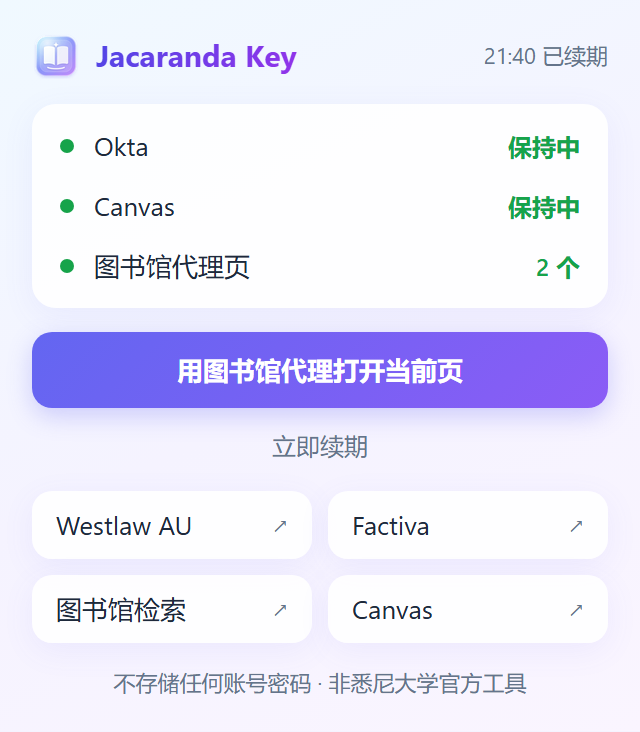

**中文** | [English](README.en.md)

# Jacaranda Key · USYD 防掉线与图书馆直通

给悉尼大学（USYD）学生用的 Chrome 小插件，只做两件事：

1. **少掉线**：浏览器开着时，每 18 分钟续一次 Okta / Canvas 登录；在 Okta 登录页自动勾上「保持登录」。
2. **图书馆直通**：在期刊、新闻等外部网站上点一下，用悉大图书馆的 OpenAthens 通道重新打开当前页。另有 Westlaw AU、Factiva、图书馆检索、Canvas 四个快捷入口。

**不存储、不读取、不填写任何账号、密码或验证码。**



> 仅供个人学习使用，与悉尼大学官方无关。使用前请先看文末的[免责声明](#免责声明)。

---

## 安装（约 3 分钟）

### 1. 下载

在本页右侧的 **Releases** 里下载最新的 `jacaranda-key-v*.zip`。

### 2. 解压到一个固定位置

右键 zip → 全部解压缩，**放到一个以后不会删的地方**，比如 `文档\jacaranda-key`。

- 插件运行时一直要用这个文件夹，删掉或挪走，插件就失效了。
- 打开文件夹，确认**一打开就能直接看到 `manifest.json`**。如果里面还套着一层文件夹，下一步就选里面那一层。

### 3. 加载到 Chrome

1. 地址栏输入 `chrome://extensions`，回车
2. 打开右上角的 **「开发者模式」**
3. 点左上角的 **「加载已解压的扩展程序」**
4. 选中能直接看到 `manifest.json` 的那个文件夹

其它基于 Chromium 的浏览器（如 Edge）步骤类似，但作者只在 Chrome 上测试过。

### 4. 把图标钉出来

点右上角的拼图图标 🧩 → 找到 **Jacaranda Key** → 点图钉 📌。

### 5. 确认装好了

1. 先正常登录一次 Canvas（https://canvas.sydney.edu.au）
2. 点插件图标 → 点「立即续期」
3. 图标角标显示 **ON** 表示正在保持登录；显示 **EXP** 表示当前没登录，正常登录一次即可。

---

## 怎么用

- **遇到付费墙**：在那个页面点插件图标 →「用图书馆代理打开当前页」，第一次会让你用 UniKey 登录（插件会自动帮你选 UniKey 通道）。
  - 在悉大自己的页面（Canvas、Okta 登录页、图书馆网站）上，按钮会变灰，因为这些页面本来就不需要代理。
- **快捷入口**：弹窗下方四个链接，点了会直接打开新标签页。

---

## 常见问题

**关掉浏览器或重启电脑后，还要重新登录吗？**
一般不用。插件会把悉大登录的 cookie 保存 400 天，浏览器重新打开后可以接着用。
不过如果关掉太久、学校那边的登录已经过期，还是要重新登录一次，之后插件会接着帮你续期。
插件本身会一直装在浏览器里，只要那个文件夹没被删或挪走。

**无痕窗口能用吗？**
能，但要先手动开一下（Chrome 默认不让插件在无痕窗口里运行）：
`chrome://extensions` → Jacaranda Key →「详细信息」→ 打开 **「在无痕模式下启用」**。
打开后，无痕窗口里的登录也会每 18 分钟续一次。无痕窗口全部关掉后，里面的登录照常清空，插件不会保存。

**点代理后出现 "We are sorry that we cannot complete your request"？**
这表示 OpenAthens 不认识你要打开的网站：要么是悉大图书馆没有通过 OpenAthens 订阅这个资源，要么当前页面本身不是一个资源页面（比如登录页）。

**加载时报错「清单文件缺失或不可读」？**
选错了文件夹层级。要选**一打开就能看到 `manifest.json`** 的那一层。

**一直显示 EXP？**
先手动登录一次 Canvas，再点「立即续期」。

**怎么更新？**
下载新版 → 覆盖旧文件夹里的文件 → 打开 `chrome://extensions` → 在 Jacaranda Key 的卡片上点刷新 🔄。

**怎么卸载？**
`chrome://extensions` → Jacaranda Key →「移除」，然后删掉文件夹。

---

## 安全说明

**它做什么、不做什么**

- 不存储、不读取、不填写任何账号、密码或验证码。
- 不会把数据发给作者，也不连接任何第三方服务器。网络请求只发往：
  - `sso.sydney.edu.au`（Okta 续期）
  - `canvas.sydney.edu.au`（检查 Canvas 是否在线）
  - 你已打开的 `*.proxy.openathens.net` 图书馆代理页（续期）
- 在网页上只做两个动作：Okta 登录页勾上「保持登录」；OpenAthens 页面点选 UniKey 通道。
- 只改 `sso.sydney.edu.au` 这一个网站的登录 cookie 的保存时间（让它撑过浏览器重启），不读取 cookie 内容，也不发往别处。无痕窗口的 cookie 不动。
- 申请的权限：`alarms`（定时）、`storage`（保存上次续期的结果）、`activeTab`（点按钮时读取当前页面的网址）、`cookies`（上面那条），以及上面几个网站的访问权限。

**需要你知道的**

- **登录保持得越久，别人用你的电脑时也越容易进你的账号。** 关掉浏览器后登录依然有效，所以公共电脑和别人的电脑上不要装，自己的电脑请设好锁屏密码。想彻底退出，在悉大网站上点「退出登录」就行。
- 手动加载的插件**不会自动更新**。好处是作者也没法远程往你电脑里推改动；坏处是需要你自己下载新版。
- **只从本仓库下载。** 别人转发、二次打包的版本可能被改过。想自己核对的话，可以用记事本打开几个 `.js` 文件、搜索 `http`，出现的网址应该只属于 `sydney.edu.au`、`openathens.net`、`exlibrisgroup.com` 这几个域名。

文件清单：

```
manifest.json          插件配置
background.js          每 18 分钟续期
content-okta.js        只勾「保持登录」
content-openathens.js  在 OpenAthens 页面自动选 UniKey
popup.html / popup.js  弹窗
icons/  docs/          图片
```

---

## 免责声明

小小声说几句喵 🐾

- 这是一个学生**为了自己学习方便**随手做的小工具，和悉尼大学没有任何关系，学校也没有给它盖过章。
- **UniKey 请只自己用，不要借给别人，也不要帮别人登录哦。** 悉大的 [ICT 使用规定](https://www.sydney.edu.au/policies/a-to-z-policy/acceptable-use-of-ict-resources-policy.html)里写着：你要对自己大学账号下的所有活动负责。
- 使用本插件时，建议遵守悉尼大学的相关规定以及图书馆电子资源的使用条款~
- 它是「原样」送给你的：没有保修，学校系统一更新，它可能就突然罢工了。用了之后发生什么，都要你自己负责，作者没办法替你兜底，还请多多包涵喵。

（正式一点的说法：本软件按「现状」提供，不作任何明示或暗示的保证；因使用本软件产生的任何后果由使用者自行承担。）

## License

[MIT](LICENSE)
